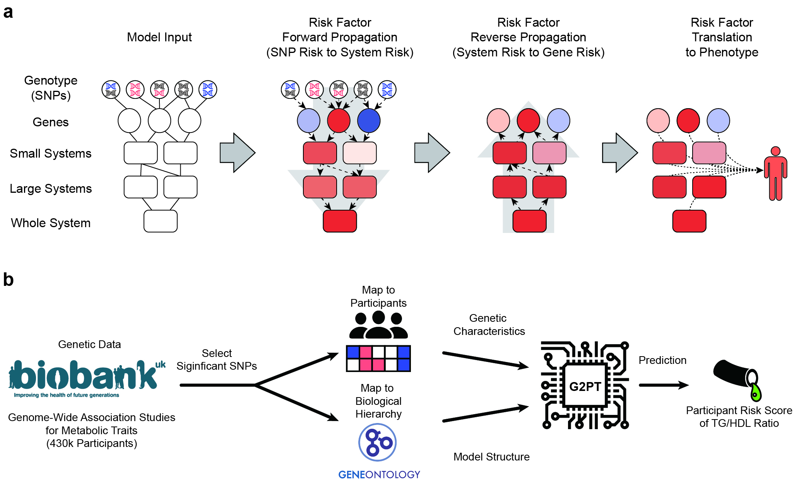

# G2PT: A genotype-phenotype transformer to assess and explain polygenic risk

[](https://doi.org/10.5281/zenodo.19713271)

## Overview

Genome-wide association studies have linked millions of genetic variants to human phenotypes, yet translating those findings into clinical insight is limited by interpretability and genetic interactions. G2PT is a hierarchical Genotype-to-Phenotype Transformer that models bidirectional information flow among polymorphisms, genes, molecular systems, and phenotypes. It has been applied to predict metabolic traits in the UK Biobank (e.g., diabetes risk and TG/HDL ratio) and to surface pathway-level explanations through attention weights.



## Key capabilities

- Hierarchical transformer with SNP → gene → system → phenotype message passing and optional system ↔ environment edges.
- **Sparse edge-based attention** that avoids materializing mostly empty dense attention matrices (enabled by default).
- Works with PLINK binary files or tab-delimited genotype matrices; supports multiple phenotypes (binary via `--bt`, quantitative via `--qt`).
- Distributed training via `torchrun`, with early stopping, masked-language-model pretraining (`--mlm`), and mixture-of-experts predictors (`--use_moe`).
- Predict-only and attention-export pipeline for downstream interpretation.
- Companion notebooks for ontology curation, visualization, Sankey plots, and epistasis exploration.

## Environment setup

The reference environment is defined in `environment.yml`. It targets Linux with
Python 3.8 and an NVIDIA CUDA-enabled PyTorch installation. CUDA and driver
compatibility should be checked for the host system before creating the environment.

```bash
conda env create -f environment.yml
conda activate G2PT_github
# From the repository root so `src/` is importable
export PYTHONPATH=.
```

## Input preparation

1. **Genotypes**
   - PLINK binary files (`.bed/.bim/.fam`) passed via `--train-bfile` and `--val-bfile`. Evaluate a held-out set with `predict_attention.py` and `--bfile`.
   - Tab-delimited genotype matrices (rows = IID, columns = variant IDs) passed via `--train-tsv` and `--val-tsv`. The current TSV loader requires integer-valued variant IDs in the header; use PLINK input for IDs such as `chr:pos:ref:alt`.
   - Training allele metadata are stored in each checkpoint. PLINK validation and prediction inputs are checked against this reference, reversed allele order is aligned automatically, and incompatible alleles or missing required variants cause an error.

2. **Covariates and phenotypes**
   - Tab-separated text matching PLINK `.cov` / `.pheno` conventions. Provide columns for `FID` and `IID` plus any covariates/phenotypes.
   - Restrict covariates with `--cov-ids SEX AGE PC1 PC2 ...`. Declare phenotype types with `--bt` (binary) and `--qt` (quantitative). Supply phenotype files explicitly for training and validation.

   *Example covariates* ([samples/synthetic_train.cov](samples/synthetic_train.cov)):

   | FID      | IID      | SEX | AGE | PC1 | PC2 | ... | PC10 |
   |----------|----------|-----|-----|-----|-----|-----|------|
   | 10008090 | 10008090 | 1   | 48  | 3   | 0.3 | ... | 0.5  |

   *Example phenotypes* ([samples/synthetic_train.pheno](samples/synthetic_train.pheno)):

   | FID      | IID      | PHENOTYPE |
   |----------|----------|-----------|
   | 10008090 | 10008090 | 1.2       |

3. **Ontology / hierarchy** (`--onto`)
   - Tab-delimited file with three columns: parent term, child term (term or gene), and `interaction_type` (e.g., `default` for term→term edges or `gene` for term→gene annotations). For nested subtrees, supply custom interaction types and pass them through `--interaction-types`.

   *Example ontology* ([samples/ontology.txt](samples/ontology.txt)):

   | parent     | child      | interaction_type |
   |------------|------------|------------------|
   | GO:0045834 | GO:0045923 | default          |
   | GO:0045834 | GO:0043552 | default          |
   | GO:0045923 | AKT2       | gene             |
   | GO:0045923 | IL1B       | gene             |
   | GO:0043552 | PIK3R4     | gene             |

4. **SNP-to-gene mapping** (`--snp2gene`)
   - Tab-delimited mapping of SNP IDs to genes. Optional columns such as `chr`, `pos`, or `block_ind` are ingested when present. PLINK `.bim` information overrides overlapping fields.

   *Example mapping* ([samples/snp2gene.txt](samples/snp2gene.txt)):

   | snp              | gene  | chr | pos       |
   |------------------|-------|-----|-----------|
   | 16:56995236:A:C  | CETP  | 16  | 56995236  |
   | 8:126482077:G:A  | TRIB1 | 8   | 126482077 |
   | 19:45416178:T:G  | APOC1 | 19  | 45416178  |
   | 2:27752463:A:G   | GCKR  | 2   | 27752463  |

If you want to collapse a Gene Ontology file using GWAS summary statistics, start with the notebooks in the [G2PT pipeline](#g2pt-pipeline-in-overall).

## Synthetic sample data

The `samples/` directory contains fully synthetic data generated for demonstration and format validation only — no real participant data.

### Regenerate sample files

```bash
python samples/generate_synthetic_data.py
```

This produces a 1000 / 500 / 300 train / val / test split with 293 SNPs.  All seven file types are written:

| File | Description |
| ---- | ----------- |
| `*.bed / *.bim / *.fam` | PLINK binary genotypes (SNP-major, GRCh38-like positions) |
| `*.pheno` | Continuous phenotype (`FID IID PHENOTYPE`) |
| `*.cov` | Covariates: SEX, AGE, AGE² (centered), PC1–PC10 |
| `snp2gene.txt` | SNP → gene mapping (`snp gene`) |
| `ontology.txt` | GO-like DAG edges (`parent child type`) |

Key generation parameters (all overridable via CLI flags — see `samples/README.md`):

| Flag | Default | Meaning |
| ---- | ------- | ------- |
| `--n_train` | 1000 | Training samples |
| `--n_val` | 500 | Validation samples |
| `--n_test` | 300 | Test samples |
| `--n_snps` | 293 | Total SNPs |
| `--seed` | 42 | Reproducibility seed |

Genotypes are simulated with realistic MAF spectrum and LD block structure; the phenotype combines additive SNP effects, pairwise epistatic interactions (see [`src/utils/analysis/epistasis_simulation.py`](src/utils/analysis/epistasis_simulation.py)), and Gaussian noise scaled to unit variance.

### Validate with PLINK polygenic scoring

A ready-to-run PLINK score pipeline is provided to sanity-check the generated data end-to-end:

```bash
bash samples/run_plink_score.sh
```

Steps performed:

1. **Generate** all splits via `generate_synthetic_data.py`
2. **GWAS** on train set — `plink --linear` with SEX / AGE / AGE² / PC1–PC10 covariates
3. **Build score file** — SNPs passing `P_THRESH` (default `5e-2`), ADD test only
4. **Score** test set — `plink --score`
5. **Evaluate** — Pearson r² of PRS vs. true phenotype

Override defaults via environment variables, e.g.:

```bash
P_THRESH=1e-3 N_TRAIN=2000 bash samples/run_plink_score.sh
```

All intermediate files (`gwas_train.assoc.linear`, `score.txt`, `prs_test.profile`) are written to `samples/plink_score_tmp/`.

---

## Training

> Sample data in `samples/` is synthetically generated and only demonstrates the CLI; it will not yield meaningful biological results.

### Single-GPU example (PLINK input)

```bash
mkdir -p outputs/run1

python train_snp2p_model.py \
  --onto samples/ontology.txt \
  --snp2gene samples/snp2gene.txt \
  --train-bfile /path/to/train \
  --train-cov /path/to/train.cov --train-pheno /path/to/train.pheno \
  --val-bfile /path/to/val \
  --val-cov /path/to/val.cov --val-pheno /path/to/val.pheno \
  --bt PHENOTYPE \
  --cov-ids SEX AGE PC1 PC2 PC3 \
  --bt-validation-metric aupr \
  --epochs 50 --batch-size 128 --val-step 20 --patience 10 \
  --hidden-dims 256 --lr 1e-3 --wd 1e-3 --dropout 0.2 \
  --sys2env --env2sys --sys2gene \
  --out outputs/run1/model.pt
```

### TSV genotype example

```bash
python train_snp2p_model.py \
  --onto samples/ontology.txt \
  --snp2gene samples/snp2gene.txt \
  --train-tsv /path/to/train_genotypes.tsv \
  --train-cov /path/to/train.cov --train-pheno /path/to/train.pheno \
  --val-tsv /path/to/val_genotypes.tsv \
  --val-cov /path/to/val.cov --val-pheno /path/to/val.pheno \
  --bt PHENOTYPE --input-format indices \
  --out outputs/run_tsv
```

### Multi-GPU (distributed data parallel)

Use `torchrun` to launch one process per GPU. Batch size and worker counts should be tuned per device.

```bash
mkdir -p outputs/run_ddp

torchrun --nproc_per_node=4 train_snp2p_model.py \
  --onto samples/ontology.txt \
  --snp2gene samples/snp2gene.txt \
  --train-bfile /path/to/train \
  --train-cov /path/to/train.cov --train-pheno /path/to/train.pheno \
  --val-bfile /path/to/val --val-cov /path/to/val.cov --val-pheno /path/to/val.pheno \
  --bt PHENOTYPE --batch-size 128 --jobs 8 \
  --sys2gene --sys2env --env2sys \
  --out outputs/run_ddp/model.pt
```

Frequently used options include `--snp2pheno` / `--gene2pheno` / `--sys2pheno` to control translation heads, `--mlm` for masked-SNP pretraining, and `--independent_predictors` for multi-phenotype outputs.

### Checkpoint selection and reproducibility

- Validation runs every `--val-step` epochs and at the final epoch. Checkpoints are written as `{out}.{epoch}`; the best validation checkpoint is `{out}.best`.
- For a binary trait, `--bt-validation-metric` selects the checkpoint criterion: `aupr` (default), `auc`, or `pseudo_r2`. The `pseudo_r2` option fits a validation-set logistic model with the G2PT score and covariates and maximizes McFadden's pseudo-R²; it requires `statsmodels` and falls back to AUPR if the fit fails.
- `--seed` controls Python, NumPy, PyTorch, worker, and distributed-sampler seeds (default: `20260916`). Checkpoints record the seed, best epoch, and selection metric.

## Sparse attention (memory optimization)

G2PT uses **sparse edge-based attention** by default to reduce memory usage during training. This is especially useful for large-scale genomic datasets with sparse SNP-to-gene and ontology mappings.

### Benefits

- Memory use scales with the number of valid hierarchy edges rather than the full pairwise attention matrix.
- Larger batches may be possible when hierarchy masks are sparse; the gain depends on the ontology, SNP-to-gene mapping, hardware, and software versions.
- Sparse and dense modes use the same hierarchy connectivity, although floating-point accumulation order can produce small numerical differences.

### Usage

Sparse attention is **enabled by default**. No flag needed to use it:

```bash
# Sparse attention enabled (default)
python train_snp2p_model.py \
  --onto samples/ontology.txt \
  --snp2gene samples/snp2gene.txt \
  ...

# To explicitly disable (not recommended unless debugging)
python train_snp2p_model.py \
  --onto samples/ontology.txt \
  --snp2gene samples/snp2gene.txt \
  --use-sparse-attention False \
  ...
```

### How it works

Instead of computing full attention matrices between all SNPs and genes (which would be mostly zero), sparse attention:

1. Precomputes sparse edge indices during dataset initialization
2. Only computes attention for valid SNP-gene, gene-system, and system-system connections
3. Uses efficient gather/scatter operations instead of dense matrix multiplication

This optimization applies to all transformer layers: SNP↔Gene, Gene↔System, and System↔System (forward/backward).

## Prediction and attention export

Use the trained checkpoint to generate predictions and (optionally) attention summaries. The loader reuses training metadata stored with the checkpoint.

```bash
python predict_attention.py \
  --onto samples/ontology.txt \
  --snp2gene samples/snp2gene.txt \
  --bfile /path/to/test \
  --cov /path/to/test.cov --pheno /path/to/test.pheno \
  --model outputs/run1/model.pt.best \
  --batch-size 256 --cuda 0 \
  --out outputs/run1/test
```

Outputs include:

- `{out}.prediction.csv`: predictions only (use `--prediction-only` to skip attention export).
- `{out}.{phenotype}.head_{k}.csv`: covariates, predictions, and attention values for attention head `k`.
- `{out}.{phenotype}.head_{k}.sys_importance.csv`: system-level attention summaries and correlations.
- `{out}.{phenotype}.head_{k}.gene_importance.csv`: gene-level summaries when the checkpoint uses `--gene2pheno`.
- Corresponding `head_sum` files containing attention summed across heads.

TSV inputs are supported via `--tsv` in place of `--bfile`.

## Documentation and API reference

The full documentation (including the API reference) is available at: <https://g2pt.readthedocs.io/en/latest/index.html>

## G2PT pipeline in overall

1. **Collapse Gene Ontology with your GWAS results**
   - Download GO Biological Process data with **[Prepare GO File](go_file.ipynb)** (thanks to @RiccardoIannaco).
   - Reduce the ontology to GWAS-relevant terms using **[Collapse Gene Ontology Based on Your GWAS Results](Collapse_Gene_Ontology_Based_on_GWAS_results.ipynb)** for a smaller, interpretable hierarchy.

2. **Train model**
   - Use the collapsed ontology and your genotype/covariate/phenotype files with `train_snp2p_model.py` (examples above or [train_model.sh](train_model.sh)).

3. **Predict with trained model**
   - Run `predict_attention.py` (see [predict_model.sh](predict_model.sh)) to obtain predictions and attention-derived importance scores.

4. **Analyze attention and epistasis**
   - Visualize high-importance systems: [Draw_ontology_with_highlighted_systems.ipynb](Draw_ontology_with_highlighted_systems.ipynb).
   - Plot attention flow: [Draw_Sankey.ipynb](Draw_Sankey.ipynb).
   - Search and visualize epistasis: [Epistasis_discovery_pipeline.ipynb](Epistasis_discovery_pipeline.ipynb).

## Epistasis Simulation

Read [Epistasis_simulation.ipynb](Epistasis_simulation.ipynb)

## License

This project is licensed under the MIT License. See the [LICENSE](LICENSE) file for details.

## Citation

If you use G2PT, please cite:

> Lee I, Wallace ZS, Wang Y, Park S, Nam H, Majithia AR, Ideker T. **A genotype-phenotype transformer to assess and explain polygenic risk.** bioRxiv. 2025. [doi:10.1101/2024.10.23.619940](https://doi.org/10.1101/2024.10.23.619940); [PMID:40291728](https://pubmed.ncbi.nlm.nih.gov/40291728/).

The archived software release is available from [Zenodo (doi:10.5281/zenodo.19713271)](https://doi.org/10.5281/zenodo.19713271).

## Future work

- [x] Apply [Differential Transformer](https://github.com/microsoft/unilm/tree/master/Diff-Transformer) to genetic-factor translation.
- [x] Build a PLINK binary-file loader using [`sgkit`](https://sgkit-dev.github.io/sgkit/latest/).
- [x] Add `.cov` and `.pheno` inputs.
- [x] Support multiple phenotypes.
- [x] Refactor configuration handling.
- [x] Add sparse attention.
- [ ] Implement additional importance methods.
- [ ] Explore causal models such as Mendelian randomization.
